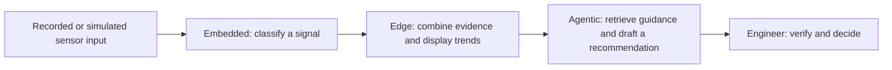

# Industrial AI: using it and building it

[Start](../README.md) · [Find your path](ASSESSMENT.md) · [Courses](CATALOG.md)

There are two entry points. **AI at work** helps you perform your profession: read technical documents, compare components, explore CAD alternatives, or develop software. **Developing AI** means creating and operating the model, inference pipeline, or agent system itself. Using an assistant to design a pneumatic assembly does not imply that the assembly contains AI.

## The brain analogy

This is our teaching model: **reflexes → local perception and coordination → planning and tool use**. It describes useful roles, not a hierarchy of intelligence or a literal model of the nervous system.

| Role | Industrial interpretation | Example learning project | Important engineering questions | Path |
|---|---|---|---|---|
| **Embedded AI — the reflex** | Small models inside a sensor, device, or controller; tight resource budgets | Classify synthetic vibration windows on a microcontroller or emulator | RAM/flash, inference deadline, energy, sampling, quantization, out-of-distribution behavior | [D1](LEARNING_PATHS.md#d1-embedded-ai) |
| **Edge AI — local perception and coordination** | Inference near the machine or cell, often with richer compute and several inputs | Local visual inspection or condition monitoring on an industrial PC/Jetson | End-to-end latency, disconnected operation, buffering, model updates, monitoring | [D2](LEARNING_PATHS.md#d2-edge-ai) |
| **Agentic AI — planning and tool use** | A system selects steps and calls tools to work toward an objective | An assistant searches fictional maintenance documents and drafts a work recommendation | Evidence, tool permissions, completion criteria, iteration limits, handover | [D3](LEARNING_PATHS.md#d3-agentic-ai-and-loops) |

The categories overlap. Embedded AI is often a subset of edge deployment; some edge systems run on embedded hardware. Agentic AI can execute locally, on an edge server, or in the cloud. Cloud training does not make a deployed microcontroller model a cloud inference system. A fixed inference pipeline need not be agentic.

Technical starting points: [TFLite Micro](https://github.com/tensorflow/tflite-micro) for constrained inference, [NVIDIA's edge tutorials](https://developer.nvidia.com/embedded/learn/tutorials) for richer local compute, and [agent workflow patterns](CATALOG.md#r01) for orchestration.

## One example across all three roles

Imagine a fictional compressed-air training rig. A device classifies a vibration pattern; a local computer combines observations and displays a trend; an assistant looks up a relevant manual section and drafts an inspection note. Each layer has its own tests and owner.

For the exercises, recommendations end with a person. This diagram does not connect a language model to machine actuation. An ML inference time measurement alone does not establish hard real-time behavior, and the metaphor says nothing about safety certification.

## AI at work has its own learning goals

| Profession/activity | Useful AI-supported task | What the learner must still verify | Route |
|---|---|---|---|
| Knowledge work and office copilots | Summarize public material, prepare a decision brief, extract action items | Source support, omissions, calculations, ownership | [W1](LEARNING_PATHS.md#w1-knowledge-work-and-copilots) |
| Mechanical and CAD design | Explore geometry alternatives, prepare requirements, explain tradeoffs | Loads, boundary conditions, manufacturability, tolerances, simulation assumptions | [W2](LEARNING_PATHS.md#w2-cad-and-mechanical-design) |
| Electronics and ECAD | Compare datasheets, suggest components, prepare a schematic review | Ratings, units, pinouts, footprints, derating, simulation/ERC/DRC results | [W3](LEARNING_PATHS.md#w3-electronics-and-pcb-design) |
| Software engineering | Explore a codebase, implement a scoped change, run verification loops | Requirements, diff, meaningful tests, dependencies, operational effects | [W4](LEARNING_PATHS.md#w4-agentic-coding) |

Generative design includes constraint-driven optimization and is broader than LLM prompting. A chatbot-generated CAD script, a geometry optimizer, and an agent operating a CAD tool are different mechanisms. Learn to recognize which one is actually in use.

## Choose the smallest useful system

Start with the work and evidence, then choose technology. A threshold, ordinary script, lookup table, or optimizer is a legitimate baseline. If a constrained device meets the requirement, an LLM is not a prerequisite. If the task needs a document draft, model training is not a prerequisite either.

Move from W4 to D3 when you need to build and evaluate an agent, rather than only use a coding assistant. Move from D4 to D1/D2 when a model needs to run near the physical process. Move between paths when your goal changes; no one needs to complete the whole catalogue.
